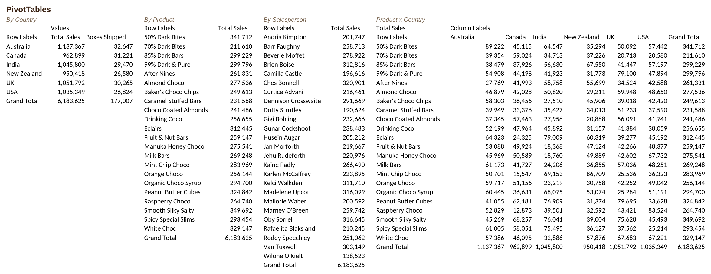

🍫 Chocolate Sales Analytics – Excel

An Excel-based data analysis project focused on exploring chocolate sales performance, identifying business trends, and generating meaningful insights using Microsoft Excel.

⸻

📊 1. Project Overview

This project analyzes chocolate sales data using Microsoft Excel. It focuses on sales performance, product analysis, country-wise sales, and business metrics through Excel functions, Pivot Tables, charts, and dashboard visualizations.

The objective is to transform raw sales data into meaningful information that supports data-driven business decisions.

🖼️ 2. Dashboard Preview

The following image provides a preview of the Chocolate Sales Excel Dashboard.

[Click here to view the Excel Dashboard Screenshot](./excel_analysis.png)

🎯 3. Business Objectives

* Analyze overall chocolate sales performance.
* Identify top-performing chocolate products.
* Compare sales across different countries.
* Evaluate sales representative performance.
* Understand monthly sales trends.
* Identify business opportunities through data analysis.
* Present key business insights using Excel visualizations.

📈 4. Key Performance Indicators (KPIs)

The analysis focuses on the following performance metrics:

* Total Sales Revenue
* Total Boxes Shipped
* Total Shipments
* Average Sales
* Product-wise Sales Performance
* Country-wise Sales Performance

📊 5. Excel Analysis and Visualizations

The project uses Excel features to explore and present sales data.

* Pivot Tables: Summarize and analyze sales information.
* Pivot Charts: Visualize sales performance and trends.
* Sales Analysis: Compare product-wise and country-wise performance.
* Trend Analysis: Understand changes in sales over time.
* KPI Analysis: Highlight important business metrics.
* Dashboard: Present key insights in a structured visual format.

🛠️ 6. Tools and Technologies

Tool / Feature	Purpose
Microsoft Excel	Data analysis and dashboard creation
Pivot Tables	Data summarization
Pivot Charts	Data visualization
Excel Formulas	Calculations and KPI analysis
Conditional Formatting	Highlight important insights
CSV	Source dataset

📂 7. Project Files

File Name	Description
chocolate_sales_analysis.xlsx	Excel analysis and dashboard
excel_analysis.png	Excel dashboard screenshot and preview

🚀 8. How to Access the Excel Dashboard

1. Navigate to the excel folder in this repository.
2. Download chocolate_sales_analysis.xlsx.
3. Open the file using Microsoft Excel.
4. Explore the analysis, charts, Pivot Tables, and dashboard.
5. Use available filters and slicers, if included, to interact with the analysis.

Note: Microsoft Excel or a compatible spreadsheet application is required to open the workbook.

🏆 9. Project Outcomes

* Analyzed chocolate sales data using Microsoft Excel.
* Identified product-wise and country-wise sales patterns.
* Evaluated sales performance using KPIs.
* Created visual summaries to communicate business insights.
* Developed practical skills in Excel data analysis and visualization.
* Converted raw sales information into meaningful business insights. 

👨‍💻 10. Author

Ahamed Irfan N

Aspiring Data Analyst | Python(pandas,numpy)| SQL | Excel | Power BI
