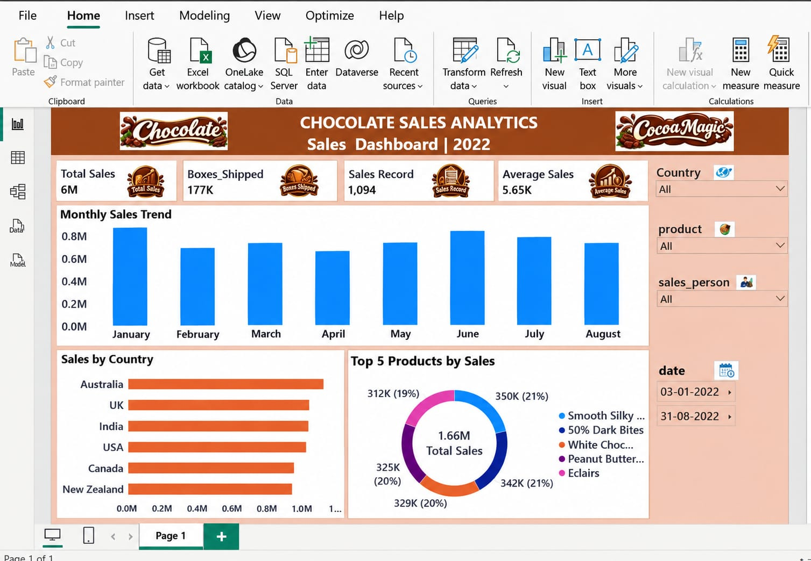

🍫 Chocolate Sales Analytics Dashboard – Power BI

An interactive business intelligence dashboard developed using Microsoft Power BI to analyze chocolate sales performance, identify business trends, and generate actionable insights.

⸻

📊 1. Dashboard Overview

The Chocolate Sales Analytics Dashboard provides a comprehensive view of sales performance across products, countries, sales representatives, and time periods.

It transforms raw sales data into meaningful visual insights to support business analysis and data-driven decision-making.

🖼️ 2. Dashboard Preview

The following screenshot provides a preview of the interactive Power BI dashboard.

[Click here to view the Dashboard Screenshot](./dashboard.png)

🎯 3. Business Objectives

* Analyze overall chocolate sales performance.
* Identify top-performing chocolate products.
* Compare sales performance across different countries.
* Evaluate individual sales representative performance.
* Monitor monthly sales trends and patterns.
* Understand shipment and box distribution.
* Generate insights to support business decisions.

📈 4. Key Performance Indicators (KPIs)

The dashboard focuses on important business performance metrics:

* Total Sales Revenue
* Total Boxes Shipped
* Total Shipments
* Average Sales
* Product-wise Sales Performance
* Country-wise Sales Performance

📊 5. Dashboard Visualizations

The dashboard uses interactive visualizations to present sales insights.

Visualization	Purpose
Sales by Country	Compare country-wise sales performance
Sales by Product	Identify top-performing products
Monthly Sales Trends	Analyze sales over time
Sales Representative Analysis	Evaluate salesperson performance
Shipment Analysis	Understand shipment distribution
KPI Cards	Display key business metrics

🎛️ 6. Interactive Dashboard Filters

Interactive slicers and filters allow users to explore the data from different perspectives.

* Country-wise filtering
* Product-wise filtering
* Date and time-period filtering
* Sales representative filtering
* Dynamic interaction between dashboard visualizations

🛠️ 7. Tools and Technologies

Tool / Technology	Purpose
Microsoft Power BI	Dashboard development and visualization
Power Query	Data cleaning and transformation
DAX	Calculations and KPI measures
Microsoft Excel	Data analysis and preparation
CSV	Source dataset

🚀 8. How to Access the Dashboard

Follow these steps to explore the interactive dashboard:

1. Navigate to the powerbi folder in this repository.
2. Download chocolate_sales_dashboard.pbix.
3. Open Microsoft Power BI Desktop.
4. Select File → Open.
5. Choose the downloaded .pbix file.
6. Explore the dashboard using the available filters and visualizations.

Note: Microsoft Power BI Desktop is required to open and interact with the .pbix file.

🏆 9. Project Outcomes

* Developed an interactive dashboard to monitor chocolate sales performance.
* Identified product-wise and country-wise sales patterns.
* Analyzed sales representative performance.
* Presented business KPIs through meaningful visualizations.
* Improved understanding of sales trends and shipment performance.
* Demonstrated practical skills in business intelligence and data visualization.

👨‍💻 10. Author

Ahamed Irfan N

Aspiring Data Analyst | Python(pandas) |numpy| SQL | Excel | Power BI
